<div align="center">

<!-- BADGE:START --><a href="https://github.com/quantamsage?tab=repositories"></a><!-- BADGE:END -->


</div>

> [!NOTE]
> Every AI model ships with a **model card**: what it is, what it's for, how it was evaluated, and where it falls short.
> Judy evaluates AI for a living, so here is hers.


## 📇 Model details

| | |
|:--|:--|
| **Developed by** | Quantam Sage |
| **Model type** | Human · AI evaluator who also builds the tools |
| **Specialisation** | AI output evaluation · inter-rater agreement · LLM-as-a-judge reliability · annotation QA · grounded generation |
| **Languages** | Python · Go · TypeScript · SQL |
| **Release** | `sage.v2026`, with <!-- COUNT:START -->31<!-- COUNT:END --> public checkpoints |
| **License** | 🟢 Open to work |

## 🎯 Intended use

- ✅ Roles in **AI evaluation, data quality and analytics**
- ✅ Designing rubrics, and measuring whether raters (human or model) actually agree
- ✅ Building AI tools that show their sources and survive their own tests

**Out-of-scope use**

- ❌ Inventing citations, DOIs or metrics (`citewise-ai` refuses to)
- ❌ Shipping code that hasn't been tested
- ❌ Vibes-based evaluation


## 📊 Benchmark highlights


## 🧪 Evaluation protocol


| Checkpoint | Result | Evidence |
|:--|:--:|:--|
| Measures rater agreement | ✅ | Cohen's kappa, exact agreement and overturn rate across independent scorers in `rubricops` |
| Knows when an AI judge is biased | ✅ | Position and verbosity bias against ~3,300 MT-Bench expert votes in `judgecheck` |
| Audits training labels | ✅ | Flags contradictions, duplicate rationales and speed anomalies, with evidence for each, in `labellint` |
| Doesn't let AI invent sources | ✅ | Every quote checked against its source page in `reference-based-revision-tool`; only real Crossref/OpenAlex records in `citewise-ai` |
| Tests before shipping | ✅ | 92 tests + CI in `judgecheck` · 97% coverage in `labellint` · Playwright browser tests in `rubricops` |
| Sandboxed patch evaluation | 🔄 | `patchbench` runs a repo's own tests in isolated Docker containers (in progress) |


## 📦 Released checkpoints

<!-- PROJECTS:START -->
**🧪 AI evaluation & data quality**

<p align="center">
  <a href="https://github.com/quantamsage/rubricops"></a>
  <a href="https://github.com/quantamsage/judgecheck"></a>
  <a href="https://github.com/quantamsage/labellint"></a>
  <a href="https://github.com/quantamsage/patchbench"></a>
  <a href="https://github.com/quantamsage/llm-response-evaluator"></a>
</p>


**📚 Grounded AI apps**

<p align="center">
  <a href="https://github.com/quantamsage/reference-based-revision-tool"></a>
  <a href="https://github.com/quantamsage/citewise-ai"></a>
  <a href="https://github.com/quantamsage/github-resume-generator"></a>
  <a href="https://github.com/quantamsage/CodeDocsAI"></a>
  <a href="https://github.com/quantamsage/SimilarMusic"></a>
  <a href="https://github.com/quantamsage/MailSense"></a>
  <a href="https://github.com/quantamsage/lumen-ai-video-summarizer"></a>
  <a href="https://github.com/quantamsage/ai-movie-recommender"></a>
  <a href="https://github.com/quantamsage/ai-quiz-generator"></a>
  <a href="https://github.com/quantamsage/secassess-mcp"></a>
  <a href="https://github.com/quantamsage/coding-tutor"></a>
</p>


**🛠️ Web apps**

<p align="center">
  <a href="https://github.com/quantamsage/shoebox"></a>
  <a href="https://github.com/quantamsage/school-management-system"></a>
  <a href="https://github.com/quantamsage/contractor-application"></a>
  <a href="https://github.com/quantamsage/Docx-editor"></a>
  <a href="https://github.com/quantamsage/FeatureFlow"></a>
  <a href="https://github.com/quantamsage/hirepath"></a>
  <a href="https://github.com/quantamsage/snaplink"></a>
  <a href="https://github.com/quantamsage/gatherly"></a>
  <a href="https://github.com/quantamsage/fairshare"></a>
  <a href="https://github.com/quantamsage/whatsapp-storefront"></a>
  <a href="https://github.com/quantamsage/inkwell"></a>
  <a href="https://github.com/quantamsage/helpdesk-hub"></a>
  <a href="https://github.com/quantamsage/PriceScout"></a>
  <a href="https://github.com/quantamsage/DevShowCase"></a>
  <a href="https://github.com/quantamsage/kanban"></a>
</p>
<!-- PROJECTS:END -->


## 🏋️ Training activity

<picture>
  <source media="(prefers-color-scheme: dark)" srcset="https://raw.githubusercontent.com/quantamsage/quantamsage/output/training-dark.svg">
  
</picture>

<details>
  <summary>Full contribution calendar</summary>
  <picture>
    <source media="(prefers-color-scheme: dark)" srcset="https://raw.githubusercontent.com/quantamsage/quantamsage/output/calendar-dark.svg">
    
  </picture>
</details>

## 🧰 Architecture

<p align="center">
  
</p>

## ⚠️ Known limitations

An honest model card lists what isn't finished yet.

- 🔄 **PatchBench is in progress.** Sandboxed patch evaluation is the current focus.
- ⏳ **JudgeCheck's model-judge study is still running.** Results get published when they're real, not before.
- 🧪 **LabelLint's scores come from synthetic data**, and its README says so.


## 📎 Citation

If this model is useful to you, please cite it. Better still, get in touch:

```bibtex
@person{ndungu2026judy,
  name   = {Quantam Sage},
  focus  = {AI evaluation, data quality, analytics},
  github = {github.com/quantamsage},
  email  = {judyjudith119@gmail.com},
  status = {open to work}
}
```

<div align="center">

<a href="mailto:judyjudith119@gmail.com"></a>
<a href="https://github.com/quantamsage"></a>
<!-- LINKEDIN: replace YOUR_LINKEDIN, then delete this comment's opening and closing markers to show it.
<a href="https://linkedin.com/in/YOUR_LINKEDIN"></a>
-->

</div>


